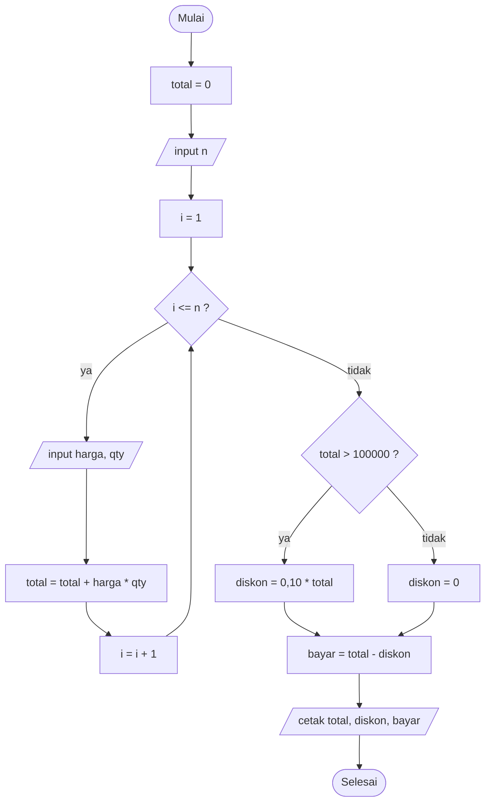
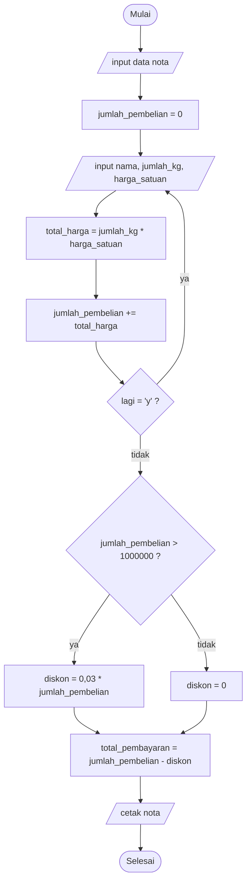

# Pembahasan Lengkap UTS Algoritma & Pemrograman UMS
## 2024/2025 (30 Oktober 2024) & 2025/2026 (29 Oktober 2025)

Dokumen ini membahas **seluruh soal** dari dua berkas:
- `Algoritma dan Pemrograman.pdf` — UTS Gasal 2024/2025, Tipe A & Tipe B
- `Algoritma dan Pemrograman Reguler 25.pdf` — UTS Gasal 2025/2026

Keduanya: mata kuliah Algoritma dan Pemrograman, Semester 1, durasi 90 menit,
CPMK 1 = "mampu menganalisis cara kerja sistem komputer" (55) dan
CPMK 2 = "mampu menganalisis persoalan computing yang kompleks…" (45).

---

## 0. Ringkasan pola soal

| Aspek | 2024/2025 | 2025/2026 |
|---|---|---|
| Bentuk | 2 tipe (A oleh Husni Thamrin, B oleh Arif Setiawan) | 1 paket untuk kelas 1/ABCD |
| Konsep dasar | 3 perintah dasar: menampilkan, menyimpan, meminta data (30) | Definisi algoritma, algoritma vs flowchart, struktur program (15) + program 2 input (10) |
| Studi kasus | Nota pembelian kopi: multi-item, diskon 3% di atas Rp1.000.000 (90) | Kasir minimarket: diskon 10% di atas Rp100.000; algoritma + flowchart (40) |
| Translasi algoritma → Python | Ya (jumlah(kol), 30) | Tidak diminta eksplisit, tetapi muncul sebagai kemampuan dasar |
| Tracing kode | Ya — slicing NIM (30) | Ya — slicing NIM, **kode identik** (35) |
| Total | 30+30+30+10 / 90+10 | 25+40+35 |

**Kesimpulan pola:** dua tahun berturut-turut menguji lima kemampuan yang sama —
(1) konsep algoritma & notasi, (2) variabel dan tipe data, (3) input/proses/output,
(4) percabangan & perulangan, (5) *string slicing* dan operator (`//`, `%`, `**`).
Yang berubah hanya kemasannya: 2024 menekankan **implementasi**, 2025 menekankan
**konsep + flowchart**.

---

# BAGIAN I — UTS 2025/2026

## Soal 1a. Apa yang Anda ketahui dari Algoritma? (5 poin)

**Jawaban.**

Algoritma adalah **urutan langkah logis, terbatas, dan tidak ambigu** untuk
menyelesaikan suatu masalah atau mencapai tujuan tertentu. Setiap langkah harus
dapat dijalankan (efektif), dan bila dijalankan dengan input yang sama akan
menghasilkan output yang sama.

Kata *algoritma* berasal dari nama ilmuwan Persia abad ke-9, **Al-Khwarizmi**
(Abu Abdullah Muhammad ibn Musa al-Khwarizmi).

Ciri algoritma yang baik (5 syarat klasik):

| Ciri | Arti |
|---|---|
| **Finiteness** | jumlah langkah terbatas, pasti berhenti |
| **Definiteness** | tiap langkah jelas, tidak menimbulkan tafsir ganda |
| **Input** | boleh nol atau lebih data masukan |
| **Output** | minimal satu hasil |
| **Effectiveness** | tiap langkah cukup sederhana untuk dikerjakan |

Contoh sederhana — algoritma menghitung luas persegi panjang:

```
1. Masukkan panjang (p)
2. Masukkan lebar (l)
3. Hitung luas <- p * l
4. Tampilkan luas
5. Selesai
```

**Kaitan dengan Python:** algoritma di atas ditulis dalam bahasa manusia/pseudocode;
implementasinya di Python:

```python
p = float(input("Panjang: "))
l = float(input("Lebar   : "))
luas = p * l
print("Luas   :", luas)
```

---

## Soal 1b. Apakah algoritma sama dengan flowchart? Jelaskan. (5 poin)

**Jawaban: tidak sama.**

| Algoritma | Flowchart |
|---|---|
| Konsep/isi: urutan langkah penyelesaian masalah | Alat bantu visual: gambar alur langkah |
| Bahasa bebas: kalimat, pseudocode, kode | Simbol baku (terminator, proses, decision, I/O) |
| Bisa ada tanpa flowchart | Flowchart tanpa algoritma tidak bermakna |
| Menjadi dasar sebelum coding | Menjadi dokumentasi/komunikasi alur |

Analogi: algoritma adalah **resep masakan**, flowchart adalah **diagram alur resep**
yang ditempel di dinding dapur. Resepnya bisa ditulis tanpa gambar, tetapi gambar
tanpa resep tidak bisa dijalankan.

Sebuah algoritma **dapat dinyatakan** dalam tiga bentuk: kalimat deskriptif,
pseudocode, atau flowchart. Jadi flowchart adalah **salah satu cara
merepresentasikan** algoritma, bukan definisi algoritma itu sendiri.

Simbol flowchart yang sering keluar di UTS:

| Simbol | Nama | Fungsi |
|---|---|---|
| Oval | Terminator | Mulai / Selesai |
| Persegi panjang | Process | Proses/perhitungan/assignment |
| Jajaran genjang | Input/Output | Membaca atau menampilkan data |
| Belah ketupat | Decision | Percabangan (ya/tidak) |
| Panah | Flow | Arah alur |
| Lingkaran kecil | Connector | Sambungan antar-halaman |

---

## Soal 1c. Menurut Anda, bagaimana struktur program yang baik? (5 poin)

**Jawaban.** Struktur program yang baik memenuhi:

1. **Pola Input → Process → Output.** Data masuk, diolah, lalu ditampilkan.
2. **Menggunakan tiga struktur kendali** (tanpa `goto` yang melompat-lompat):
   - *Sequence*: urutan lurus,
   - *Selection*: `if / elif / else`,
   - *Repetition*: `for` / `while`.
3. **Modular.** Dipecah menjadi fungsi dengan satu tanggung jawab
   (`hitung_total()`, `hitung_diskon()`, `cetak_nota()`), bukan satu blok panjang.
4. **Mudah dibaca.** Nama variabel bermakna (`total_bayar`, bukan `x`), indentasi
   konsisten, komentar pada bagian yang perlu, mengikuti PEP 8.
5. **Aman dan valid.** Input divalidasi (angka vs teks, nilai negatif), ada
   penanganan error (`try/except`).
6. **Tidak mengulang kode (DRY)** dan mudah diuji: tiap fungsi bisa diuji sendiri.
7. **Efisien secukupnya.** Tidak memakai perulangan bersarang bila satu
   perulangan cukup.

Contoh struktur buruk vs baik:

```python
# BURUK: semua menumpuk, nama tidak jelas, tanpa validasi
a = float(input())
b = float(input())
c = a * b
if c > 100000: c = c - c * 0.1
print(c)

# BAIK: terpisah, bernama jelas, ada validasi & fungsi
def hitung_total(harga: float, jumlah: int) -> float:
    """Total belanja satu item."""
    return harga * jumlah

def hitung_diskon(total: float, ambang: float = 100_000, persen: float = 0.10) -> float:
    """Diskon hanya jika total melebihi ambang."""
    return total * persen if total > ambang else 0.0

def main() -> None:
    harga = float(input("Harga satuan : Rp"))
    jumlah = int(input("Jumlah barang: "))
    total = hitung_total(harga, jumlah)
    diskon = hitung_diskon(total)
    print(f"Total  : Rp{total:,.0f}")
    print(f"Diskon : Rp{diskon:,.0f}")
    print(f"Bayar  : Rp{total - diskon:,.0f}")

if __name__ == "__main__":
    main()
```

---

## Soal 1d. Program Python: minta dua input, tampilkan masing-masing, hitung hasil keduanya (10 poin)

**Jawaban.**

```python
# minta dua input
data1 = input("Masukkan data pertama: ")
data2 = input("Masukkan data kedua  : ")

# tampilkan masing-masing input
print("Input pertama :", data1)
print("Input kedua   :", data2)

# hitung hasil keduanya (penjumlahan)
hasil = float(data1) + float(data2)
print("Hasil penjumlahan :", hasil)
```

**Contoh eksekusi**

```
Masukkan data pertama: 12
Masukkan data kedua  : 7.5
Input pertama : 12
Input kedua   : 7.5
Hasil penjumlahan : 19.5
```

**Poin yang dinilai:**

- `input()` selalu mengembalikan **string**, sehingga untuk berhitung harus
  dikonversi (`int()` bila bulat, `float()` bila boleh desimal).
- Variabel diberi nama jelas dan masing-masing input ditampilkan (diminta soal).
- Bila input bukan angka, `float()` menimbulkan `ValueError`. Versi aman:

```python
try:
    hasil = float(data1) + float(data2)
    print("Hasil penjumlahan :", hasil)
except ValueError:
    print("Input harus berupa angka.")
```

> Catatan: soal menulis "menghitung hasil dari kedua input" tanpa menyebut
> operasi. Penjumlahan adalah tafsir paling wajar; bila ingin lebih lengkap,
> tampilkan empat operasi: `+`, `-`, `*`, `/` (dengan penjagaan pembagi nol).

---

## Soal 2. Kasir minimarket: total harga + diskon 10% bila total > Rp100.000

### 2a. Algoritma (20 poin)

**Pseudocode.**

```
ALGORITMA HitungBelanjaKasir
DEKLARASI
    n, i, qty           : integer
    harga, total        : real
    diskon, bayar       : real

ALGORITMA
    total <- 0
    input(n)                          // banyak jenis barang
    for i <- 1 to n do
        input(harga)                  // harga satuan barang ke-i
        input(qty)                    // jumlah barang ke-i
        total <- total + (harga * qty)
    end for

    if total > 100000 then
        diskon <- 0.10 * total
    else
        diskon <- 0
    end if

    bayar <- total - diskon
    output(total, diskon, bayar)
    selesai
```

**Versi kalimat (bila diminta naratif):**
1. Siapkan wadah `total` bernilai 0.
2. Tanyakan berapa jenis barang yang dibeli (`n`).
3. Ulangi untuk setiap barang: masukkan harga satuan dan jumlahnya, lalu
   tambahkan `harga × jumlah` ke `total`.
4. Setelah semua barang masuk, periksa: jika `total` lebih dari 100.000,
   hitung diskon 10% dari total; jika tidak, diskon 0.
5. Hitung `bayar = total − diskon`.
6. Tampilkan total, diskon, dan jumlah yang harus dibayar.

### 2b. Flowchart (20 poin)



**Yang dinilai pada flowchart:** bentuk simbol benar (jajaran genjang untuk
input/output, belah ketupat untuk keputusan, persegi panjang untuk proses),
arah panah konsisten, ada titik Mulai dan Selesai, serta **loop kembali ke
pemeriksaan kondisi**.

### Bonus: implementasi Python

```python
n = int(input("Banyak jenis barang: "))
total = 0

for i in range(1, n + 1):
    harga = float(input(f"Harga barang ke-{i}  : Rp"))
    qty = int(input(f"Jumlah barang ke-{i} : "))
    total += harga * qty

if total > 100_000:
    diskon = 0.10 * total
else:
    diskon = 0.0

bayar = total - diskon

print("-" * 40)
print(f"Total belanja : Rp{total:,.0f}")
print(f"Diskon (10%)  : Rp{diskon:,.0f}")
print(f"Total bayar   : Rp{bayar:,.0f}")
```

Contoh: 3 item → 45.000 + 30.000 + 40.000 = 115.000 → diskon 11.500 →
bayar 103.500.

**Jebakan yang sering terjadi:**
- Diskon dihitung dari **total**, bukan dari harga per item.
- Ambang bersifat **lebih dari** (`>`), bukan `>=` — total tepat 100.000 tidak
  mendapat diskon.
- `total` harus diinisialisasi **sebelum** loop.
- Diskon dikurangkan setelah total selesai dihitung.

---

## Soal 3. Tracing variabel: ganti NIM pada `z = 'L200101xxx'` (35 poin)

**Kode utuh (gabungan halaman 1 & 2):**

```python
z = 'L200101010'      # ganti dengan NIM Anda
m = z[9:6:-1]
n = int(m[0])
p = int(m) + 19
q = 15 - n
r = p // 10
s = 2 * m
t = p % q
u = t ** 2
v = p - t
w = n < 6
```

### Kunci memahami soal

1. **`z[9:6:-1]`** — slicing dengan *step* negatif, artinya mengambil karakter
   dari indeks 9 turun sampai indeks 7 (indeks 6 tidak ikut), yaitu **tiga
   digit terakhir NIM dibalik**.
2. **`m` tetap bertipe `str`.** Maka `int(m[0])` mengambil digit pertama dari
   string tersebut, dan **`2 * m` adalah pengulangan string**, bukan perkalian
   angka.
3. Operator: `//` pembagian bulat, `%` sisa bagi, `**` pangkat.

### Trace dengan NIM contoh `L200101010`

Indeks karakter:

| indeks | 0 | 1 | 2 | 3 | 4 | 5 | 6 | 7 | 8 | 9 |
|---|---|---|---|---|---|---|---|---|---|---|
| karakter | L | 2 | 0 | 0 | 1 | 0 | 1 | 0 | 1 | 0 |

`z[9] = '0'`, `z[8] = '1'`, `z[7] = '0'` → **`m = '010'`**

| Variabel | Perhitungan | Nilai | Tipe |
|---|---|---|---|
| `m` | `z[9:6:-1]` | `'010'` | str |
| `n` | `int('0')` | `0` | int |
| `p` | `int('010') + 19` = 10 + 19 | `29` | int |
| `q` | `15 - 0` | `15` | int |
| `r` | `29 // 10` | `2` | int |
| `s` | `2 * '010'` (string!) | `'010010'` | str |
| `t` | `29 % 15` | `14` | int |
| `u` | `14 ** 2` | `196` | int |
| `v` | `29 - 14` | `15` | int |
| `w` | `0 < 6` | `True` | bool |

### Trace dengan NIM contoh `L200101209` (yang tercetak di kertas 2024)

`z[9]='9'`, `z[8]='0'`, `z[7]='2'` → `m='902'`

| Variabel | Nilai |
|---|---|
| `m` | `'902'` |
| `n` | `9` |
| `p` | `921` |
| `q` | `6` |
| `r` | `92` |
| `s` | `'902902'` |
| `t` | `3` |
| `u` | `9` |
| `v` | `918` |
| `w` | `False` |

### Trace dengan NIM `L200240189` (NIM contoh pada portal)

`z[9]='9'`, `z[8]='8'`, `z[7]='1'` → `m='981'`

| Variabel | Nilai |
|---|---|
| `m` | `'981'` |
| `n` | `9` |
| `p` | `1000` |
| `q` | `6` |
| `r` | `100` |
| `s` | `'981981'` |
| `t` | `4` |
| `u` | `16` |
| `v` | `996` |
| `w` | `False` |

Angka `p = 1000` dan `r = 100` membuat soal ini enak dipakai sebagai contoh
di kelas: pembagian bulat dan modulo menghasilkan nilai bulat bersih.

### Cara cepat mengerjakan untuk NIM Anda

1. Tulis NIM 10 karakter, beri nomor indeks 0–9.
2. Ambil karakter indeks 9, 8, 7 → itulah `m` (contoh `...010` → `'010'`).
3. `n` = digit pertama `m`.
4. `p` = nilai `m` + 19.
5. `q` = 15 − n; `r` = p // 10; `s` = m diulang dua kali; `t` = p % q;
   `u` = t²; `v` = p − t; `w` = n < 6.

Skrip siap pakai ada di `trace_nim.py` (lampiran dokumen ini). Jalankan:

```powershell
python "D:\Materi Algopro\trace_nim.py"
```

**Kesalahan umum:**
- Menghitung `2 * m` sebagai angka (padahal `m` string → `'010010'`).
- Salah arah slicing (`z[6:9]` menghasilkan urutan berbeda).
- Mengira `m` otomatis integer karena isinya angka — `int()` baru dipakai di `n` dan `p`.
- Lupa `q` tidak mungkin 0 karena `n` hanya satu digit (0–9), jadi `q` = 6–15.

---

# BAGIAN II — UTS 2024/2025 TIPE A

## Soal 1. Tiga perintah dasar: menampilkan, menyimpan, meminta data (30 poin)

**Jawaban.**

| Perintah dasar | Istilah | Python | Contoh |
|---|---|---|---|
| **Menampilkan** data | output | `print()` | `print("Total:", total)` |
| **Menyimpan** data | assignment | `=` | `total = 0`, `total = total + 5` |
| **Meminta** data | input | `input()` | `nama = input("Nama: ")` |

Penjelasan dan contoh:

**1) Menampilkan (`print`)** — mengirim data ke layar. Bisa menampilkan teks,
angka, atau gabungan.

```python
nama = "Siti"
umur = 19
print("Halo", nama, "umur kamu", umur)
print(f"Halo {nama}, umur kamu {umur}")   # f-string
```

**2) Menyimpan (`=`)** — menaruh nilai ke variabel di memori. Tanda `=` di sini
bukan "sama dengan" matematis, melainkan "isi variabel dengan".

```python
harga = 25000          # menyimpan angka
jumlah = 3
total = harga * jumlah # menyimpan hasil perhitungan
total = total + 1000   # memperbarui nilai (akumulasi)
```

**3) Meminta data (`input`)** — membaca ketikan pengguna. **Selalu menghasilkan
string**, jadi perlu konversi bila akan dihitung.

```python
nama = input("Nama Anda: ")          # str
umur = int(input("Umur Anda: "))     # dikonversi ke int
ipk  = float(input("IPK Anda: "))    # dikonversi ke float
```

Contoh program utuh yang memakai ketiganya:

```python
nama  = input("Nama pembeli : ")      # meminta
harga = float(input("Harga barang : "))  # meminta + konversi
qty   = int(input("Jumlah       : "))    # meminta + konversi

total = harga * qty                    # menyimpan (hasil hitung)
print("Terima kasih,", nama)           # menampilkan
print("Total bayar: Rp", total)        # menampilkan
```

---

## Soal 2. Tracing NIM (30 poin)

Kodenya **sama persis** dengan Soal 3 UTS 2025 (lihat halaman sebelumnya).
Bedanya hanya bobot: 30 poin di 2024, 35 poin di 2025.

Gunakan tabel trace yang sudah dibuat. Untuk NIM `L200101010`: hasilnya
`m='010'`, `n=0`, `p=29`, `q=15`, `r=2`, `s='010010'`, `t=14`, `u=196`,
`v=15`, `w=True`.

---

## Soal 3. Terjemahkan algoritma `jumlah(kol)` ke Python (30 poin)

Algoritma aslinya:

```
* kol adalah koleksi berisi angka
1. jml <- 0
2. Untuk setiap x dalam kol
      jml <- jml + x
3. RETURN jml
4. selesai
```

**Jawaban Python:**

```python
def jumlah(kol):
    """Menjumlahkan semua angka dalam koleksi kol."""
    jml = 0
    for x in kol:
        jml = jml + x      # bisa ditulis jml += x
    return jml
```

Uji:

```python
print(jumlah([10, 20, 30]))       # 60
print(jumlah((1, 2, 3, 4, 5)))    # 15
print(jumlah([]))                 # 0  (koleksi kosong tetap valid)
```

**Penjelasan yang dinilai:**

- `jml = 0` adalah **akumulator** — harus nol agar penjumlahan benar.
- `for x in kol` melakukan **iterasi** atas setiap elemen; `kol` boleh list
  atau tuple.
- `return jml` mengembalikan nilai, berbeda dengan `print(jml)` yang hanya
  menampilkan. Soal meminta `RETURN`, jadi wajib `return`.
- Fungsi bisa dipanggil berulang dengan input berbeda ( reusable).

Versi satu baris (opsional): `def jumlah(kol): return sum(kol)` — tetapi
UTS meminta terjemahan algoritma, jadi tulis versi loop-nya.

---

## Soal 4. Tanda tangan lembar HVS (10 poin)

Administratif: kumpulkan satu lembar tulisan tangan, diberi nama, ditandatangani,
diserahkan bersama lembar jawaban. Tidak ada konten teknis.

---

# BAGIAN III — UTS 2024/2025 TIPE B

## Soal 1. Analisis nota pembelian kopi (90 poin)

Data pada nota contoh:

| No | Nama Kopi | Jumlah (Kg) | Harga Satuan | Total Harga |
|---|---|---|---|---|
| 1 | Arabika Mandheling | 10 | Rp80.000 | Rp800.000 |
| 2 | Robusta Lampung | 15 | Rp65.000 | Rp975.000 |
| 3 | Liberika Aceh | 5 | Rp90.000 | Rp450.000 |
| 4 | Excelsa Sulawesi | 8 | Rp75.000 | Rp600.000 |
| | **Jumlah pembelian** | | | **Rp2.825.000** |
| | **Diskon (3%)** | | | **Rp84.750** |
| | **Total pembayaran** | | | **Rp2.740.250** |

### a. Identifikasi variabel

**Data nota (satu nilai):**

| Variabel | Tipe | Keterangan |
|---|---|---|
| `tanggal` | str | tanggal transaksi |
| `nomor_nota` | str | mis. `NP2023-0088` |
| `pemasok` | str | `PT Kopi Makmur` |
| `alamat` | str | `Jl. Pahlawan No. 45` |
| `kota` | str | `Bandung` |
| `telepon` | str | `(022) 9876-5432` |

**Data per item (berulang — butuh list/array):**

| Variabel | Tipe | Keterangan |
|---|---|---|
| `nama` | str | nama kopi |
| `jumlah_kg` | float | berat yang dibeli |
| `harga_satuan` | float | harga per kg |
| `total_harga` | float | `jumlah_kg × harga_satuan` |

**Data rekap:**

| Variabel | Tipe | Keterangan |
|---|---|---|
| `jumlah_pembelian` | float | akumulasi semua `total_harga` |
| `diskon` | float | 3% bila `jumlah_pembelian > 1.000.000`, selain itu 0 |
| `total_pembayaran` | float | `jumlah_pembelian − diskon` |

### b. Perulangan (looping)

Nota memuat **banyak item** dengan struktur data sama. Karena itu:
- gunakan **list** untuk menyimpan item (`items.append(...)`),
- gunakan **loop** untuk membaca input berulang dan menghitung total,
- jumlah perulangan = banyak item (bisa `for` sejumlah item, atau `while`
  selama pengguna masih menambah barang).

Tanpa loop, program harus menulis blok input berulang secara manual — tidak
fleksibel bila jumlah item berubah.

### c. Percabangan untuk diskon

```
if jumlah_pembelian > 1000000 then
    diskon <- 0.03 * jumlah_pembelian
else
    diskon <- 0
end if
```

Perhatikan: ambang **Rp1.000.000** dan persentase **3%**. Diskon dihitung dari
**subtotal**, bukan dari total setelah diskon.

### d. Pseudocode lengkap

```
ALGORITMA NotaPembelian
DEKLARASI
    tanggal, nomor, pemasok, alamat, kota, telepon : string
    nama : string
    jumlah_kg, harga_satuan, total_harga : real
    jumlah_pembelian, diskon, total_pembayaran : real
    lagi : karakter

ALGORITMA
    input(tanggal, nomor, pemasok, alamat, kota, telepon)
    jumlah_pembelian <- 0

    repeat
        input(nama, jumlah_kg, harga_satuan)
        total_harga <- jumlah_kg * harga_satuan
        jumlah_pembelian <- jumlah_pembelian + total_harga
        input(lagi)                     // 'y' untuk tambah item
    until lagi <> 'y'

    if jumlah_pembelian > 1000000 then
        diskon <- 0.03 * jumlah_pembelian
    else
        diskon <- 0
    end if

    total_pembayaran <- jumlah_pembelian - diskon
    output(nomor, tanggal, pemasok, jumlah_pembelian, diskon, total_pembayaran)
    selesai
```

### e. Flowchart



### f. Implementasi Python

```python
def baca_item():
    """Membaca satu item; mengembalikan (nama, kg, harga)."""
    nama = input("Nama kopi    : ")
    kg = float(input("Jumlah (kg)  : "))
    harga = float(input("Harga satuan : Rp"))
    return nama, kg, harga


def main():
    print("=" * 52)
    print("NOTA PEMBELIAN")
    print("=" * 52)
    tanggal = input("Tanggal      : ")
    nomor = input("Nomor nota   : ")
    pemasok = input("Pemasok      : ")

    items = []
    lagi = "y"
    while lagi.lower() == "y":
        items.append(baca_item())
        lagi = input("Tambah item lagi? (y/t): ")

    jumlah_pembelian = 0.0
    for nama, kg, harga in items:
        total_harga = kg * harga
        jumlah_pembelian += total_harga

    if jumlah_pembelian > 1_000_000:
        diskon = 0.03 * jumlah_pembelian
    else:
        diskon = 0.0

    total_pembayaran = jumlah_pembelian - diskon

    print("-" * 52)
    print(f"{'No':<3}{'Nama Kopi':<22}{'Kg':>6}{'Harga':>12}{'Total':>14}")
    for i, (nama, kg, harga) in enumerate(items, start=1):
        print(f"{i:<3}{nama:<22}{kg:>6g}{harga:>12,.0f}{kg * harga:>14,.0f}")

    print("-" * 52)
    print(f"Jumlah pembelian : Rp{jumlah_pembelian:>14,.0f}")
    print(f"Diskon (3%)      : Rp{diskon:>14,.0f}")
    print(f"Total pembayaran : Rp{total_pembayaran:>14,.0f}")
    print("=" * 52)


if __name__ == "__main__":
    main()
```

**Verifikasi dengan data nota:** subtotal 2.825.000 → diskon 3% = 84.750 →
total 2.740.250. Program harus menghasilkan angka yang sama.

**Catatan format:** `f"{nilai:,.0f}"` memakai pemisah ribuan gaya Inggris
(`2,825,000`). Bila ingin gaya Indonesia (`2.825.000`):
`f"{nilai:,.0f}".replace(",", ".")`.

**Rubrik Tipe B (bobot):**

| Bobot | Yang dinilai |
|---|---|
| 30% | Ketepatan identifikasi variabel + logika perulangan & percabangan |
| 30% | Kesesuaian pseudocode & flowchart dengan alur nota |
| 40% | Program berfungsi: input, loop, total, diskon |

---

# BAGIAN IV — POLA & STRATEGI BELAJAR

## 1. Lima kemampuan inti yang selalu muncul

| # | Kemampuan | Latihan kunci |
|---|---|---|
| 1 | Konsep algoritma & flowchart | hafal simbol, ubah pseudocode ↔ flowchart |
| 2 | Variabel & tipe data | bedakan `int`, `float`, `str`, `bool` |
| 3 | Input/proses/output | `input()` → konversi → hitung → `print()` |
| 4 | Percabangan & perulangan | kasus diskon, kasir, nota |
| 5 | String slicing & operator | `z[a:b:c]`, `//`, `%`, `**` |

## 2. Perbedaan tekanan tiap tahun

- **2024** — lebih dekat ke implementasi: menerjemahkan algoritma ke Python,
  studi kasus nota lengkap (variabel → pseudocode → flowchart → program).
- **2025** — lebih dekat ke konsep: definisi, perbandingan algoritma vs
  flowchart, struktur program yang baik, lalu algoritma + flowchart kasir.

Karena itu, untuk UTS berikutnya **siapkan keduanya**: mampu menjelaskan konsep
dan mampu menulis kode.

## 3. Jebakan yang paling sering menghilangkan nilai

1. `input()` dianggap angka → lupa `int()`/`float()`.
2. `2 * m` dikira perkalian padahal `m` string → hasil `'010010'`.
3. Diskon memakai `>=` padahal soal menulis "lebih dari".
4. Diskon dihitung per item, bukan dari total.
5. Flowchart keputusan digambar persegi panjang (harus belah ketupat).
6. `return` diganti `print` pada soal translasi fungsi.
7. `total` tidak diinisialisasi sebelum loop → `NameError`.
8. Salah menghitung `//` dan `%` untuk bilangan negatif (tidak muncul di soal,
   tetapi sering dipakai di kuis).
9. Format rupiah memakai pemisah yang salah — periksa kembali hasil cetak.
10. Tidak menuliskan langkah "Selesai" / "Mulai" pada flowchart.

## 4. Cara belajar yang efektif (2–3 hari sebelum ujian)

1. **Hafal pola 5 kemampuan** di atas, bukan menghafal soal.
2. Kerjakan ulang soal 2024 **tanpa melihat jawaban**, lalu bandingkan.
3. Untuk tracing NIM, buat tabel 10 kolom indeks setiap kali — jangan menghitung
   di kepala.
4. Latih menulis pseudocode dengan notasi `<-` dan `if … then … else … end if`.
5. Latih menggambar flowchart di kertas: 1 kasus diskon, 1 kasus loop.
6. Ketik ulang program kasir dan nota sampai jalan tanpa error.
7. Siapkan NIM Anda sendiri untuk soal tracing — hafalkan 3 digit terakhirnya.

---

# LAMPIRAN

## A. `trace_nim.py` — hitung otomatis untuk NIM Anda

```python
"""Trace soal UTS: z[9:6:-1] dan operasi lanjutan."""
nim = input("Masukkan NIM (10 karakter, mis. L200101010): ").strip().upper()

if len(nim) != 10:
    print(f"PERINGATAN: NIM {len(nim)} karakter; slicing mengasumsikan 10 karakter.")

z = nim
m = z[9:6:-1]
n = int(m[0])
p = int(m) + 19
q = 15 - n
r = p // 10
s = 2 * m
t = p % q
u = t ** 2
v = p - t
w = n < 6

hasil = [("m", m), ("n", n), ("p", p), ("q", q), ("r", r),
         ("s", s), ("t", t), ("u", u), ("v", v), ("w", w)]

for nama, nilai in hasil:
    print(f"{nama} = {nilai!r:<10} ({type(nilai).__name__})")
```

## B. Checklist menjawab soal algoritma

- [ ] Ada titik Mulai dan Selesai
- [ ] Semua variabel dideklarasikan dan diinisialisasi
- [ ] Input memakai simbol jajaran genjang
- [ ] Proses memakai persegi panjang
- [ ] Keputusan memakai belah ketupat dengan label ya/tidak
- [ ] Loop kembali ke kondisi, bukan ke awal program
- [ ] Diskon/percabangan memakai ambang yang benar (`>` vs `>=`)
- [ ] Output ditampilkan, bukan hanya dihitung
- [ ] Nama variabel konsisten antara algoritma, flowchart, dan kode

## C. Perbandingan bobot

| UTS | Butir | Bobot |
|---|---|---|
| 2024 Tipe A | konsep perintah dasar / tracing / translasi / administrasi | 30 / 30 / 30 / 10 |
| 2024 Tipe B | studi kasus nota (variabel, pseudocode, flowchart, program) | 90 (+10 administrasi) |
| 2025 | konsep (4 sub) / kasir (algoritma+flowchart) / tracing | 25 / 40 / 35 |

---

*Disusun dari berkas soal asli: `Algoritma dan Pemrograman.pdf` (2024/2025) dan
`Algoritma dan Pemrograman Reguler 25.pdf` (2025/2026).*
